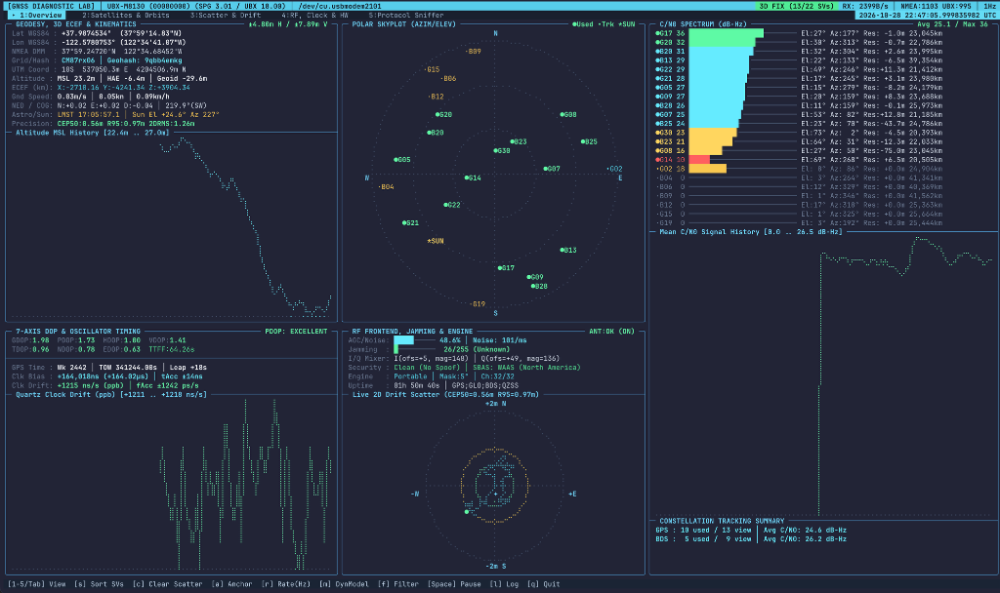

# `ubxtop` — GNSS & u-blox Hardware Diagnostic TUI

[](LICENSE)
[](https://www.python.org/)
[](#installation)

**`ubxtop`** is a zero-dependency, 24-bit TrueColor terminal diagnostic suite for **u-blox** and **NMEA 0183** GNSS receivers.

Built with a pure-ANSI cell-grid engine and **DEC Mode 2026 Synchronized Output** (designed for modern GPU terminals like **Ghostty**, Kitty, WezTerm, and iTerm2), `ubxtop` simultaneously demultiplexes ASCII **NMEA 0183** sentences and binary **u-blox UBX** frames to expose everything happening inside your GNSS receiver—from satellite orbital physics and pseudorange residuals to quartz oscillator drift and baseband I/Q mixer balance.



---

## Features

- **5 Interactive Diagnostic Views**:
  1. **`[1] Overview (Mission Control)`**:
     - **Geodesy & 3D ECEF**: WGS84 Lat/Lon (Decimal, DMS, NMEA DMM), **Maidenhead Ham Grid Locator** (8-char), **Geohash** (9-char), **UTM** Zone/Easting/Northing, **3D ECEF ($X, Y, Z$)** coordinates & velocities, MSL vs. WGS84 Ellipsoid Height (HAE) & Geoid Separation, NED velocities, Local Mean Sidereal Time (LMST), and Solar Elevation/Azimuth.
     - **High-Res Braille Polar Skyplot**: $360^\circ$ azimuth / $0^\circ\text{–}90^\circ$ elevation radar (`2×4` subpixel Unicode Braille) showing active navigation SVs (`●`), tracked SVs (`•`), and the Sun (`*SUN`).
     - **C/N0 Signal Spectrum**: Per-SV carrier-to-noise (`dB-Hz`) bars, elevation, azimuth, pseudorange residual, slant range, and per-constellation channel usage.
     - **7-Axis DOP & Precision Oscillator Timing**: `GDOP`, `PDOP`, `HDOP`, `VDOP`, `TDOP`, `NDOP`, `EDOP`, GPS Week, `iTOW`, Leap Seconds, nanosecond UTC accuracy (`±tAcc`), receiver quartz **clock bias (`ns`)**, and **clock drift (`ns/s` / ppb)**.
     - **RF Frontend & Jamming Monitor**: Antenna Supervisor (`OK`/`SHORT`/`OPEN`), AGC gain %, GPS core noise (`counts/ms`), **Continuous-Wave (CW) Jamming Indicator (`0–255`)**, **Baseband I/Q Mixer offset & magnitude**, and anti-spoofing status.
  2. **`[2] Satellites & Orbits` (`UBX-NAV-SAT` + `UBX-NAV-ORB`)**:
     - Full table of all satellites in view with signal lock quality (`Code+Carr`, `Code Lock`, `Acquired`, `Searching`), `C/N0`, `Elev`, `Azim`, **Pseudorange Residual (`prRes` in meters)**, geometric **Slant Range ($\text{km}$)**, **Speed-of-Light Propagation Delay ($\text{ms}$)**, Orbit Source (`Ephemeris`, `Almanac`, `AssistNow`), Carrier Smoothing (`SMTH`), and Health flags.
  3. **`[3] Scatter & Drift`**:
     - Live 2D East-North-Up (ENU) subpixel Braille position scatter plot with real-time **CEP50** (50% Circular Error Probable), **R95**, **2DRMS**, standard deviations ($\sigma_E, \sigma_N, \sigma_U$), and 4 live Braille time-series charts (`Altitude MSL`, `hAcc`, `Mean C/N0`, `PDOP`).
  4. **`[4] RF, Clock & Hardware`**:
     - Low-level silicon diagnostics: Baseband I/Q mixer balance (`UBX-MON-HW2`), 32-channel hardware constellation allocation (`UBX-CFG-GNSS`), per-port hardware I/O byte & framing/parity/overrun error counters across `I2C`, `UART1`, `UART2`, `USB`, and `SPI` (`UBX-MON-IO`), and ROM/firmware extensions (`UBX-MON-VER`).
     - Live interactive controls to change measurement rate (`1 / 2 / 5 / 10 Hz` via `UBX-CFG-RATE`) and navigation dynamic platform model (`Portable`, `Stationary`, `Pedestrian`, `Automotive`, `Sea`, `Airborne` via `UBX-CFG-NAV5`).
  5. **`[5] Protocol Sniffer`**:
     - Real-time packet inspector with per-message counters, age, checksum error tracking, protocol filtering (`ALL` / `NMEA` / `UBX`), stream freeze/pause, and disk logging.

---

## Installation & Quick Start

`ubxtop` uses only the Python 3 standard library—**zero external packages required**.

### Run Directly with `uvx` or `pipx`
```bash
uvx --from git+https://github.com/fuziontech/ubxtop ubxtop
```

### Or Clone and Run
```bash
git clone https://github.com/fuziontech/ubxtop.git
cd ubxtop

# Launch interactive full-screen TUI (auto-detects USB GPS on macOS & Linux):
./ubxtop

# Print a 1-shot colorized CLI diagnostic snapshot and exit:
./ubxtop --snapshot

# Run with simulated u-blox M8 telemetry (no hardware required):
./ubxtop --demo

# Specify a custom serial port:
./ubxtop -d /dev/cu.usbmodem2101
```

---

## Keyboard Shortcuts

| Key | Action |
|---|---|
| `1` – `5` / `Tab` / `←` `→` | Switch between the 5 diagnostic views |
| `s` | Cycle satellite sort (`Used + C/N0`, `Constellation/PRN`, `Elevation`, `\|Pseudorange Residual\|`) |
| `c` | Clear 2D ENU position scatter & CEP/R95 drift history |
| `a` | Toggle scatter reference between running Mean Centroid and Locked Anchor |
| `r` | Cycle receiver measurement rate (`1 Hz` / `2 Hz` / `5 Hz` / `10 Hz` via `UBX-CFG-RATE`) |
| `m` | Cycle navigation dynamic model (`Portable`, `Stationary`, `Pedestrian`, `Automotive`, `Sea`, `Airborne` via `UBX-CFG-NAV5`) |
| `f` | Cycle Protocol Sniffer filter (`ALL`, `NMEA`, `UBX`) |
| `Space` / `p` | Pause / resume live packet stream in Protocol Sniffer |
| `l` | Toggle packet logging to timestamped `gps_diag_*.log` file |
| `v` | Re-poll all UBX hardware & configuration registers |
| `q` / `Esc` | Quit |

---

## Supported Protocols & Messages

| Protocol | Decoded Messages |
|---|---|
| **u-blox Binary (`UBX`)** | `NAV-PVT` (`0x01 0x07`), `NAV-DOP` (`0x01 0x04`), `NAV-SAT` (`0x01 0x35`), `NAV-ORB` (`0x01 0x34`), `NAV-CLOCK` (`0x01 0x22`), `NAV-STATUS` (`0x01 0x03`), `NAV-TIMEGPS` (`0x01 0x20`), `NAV-POSECEF` (`0x01 0x01`), `NAV-VELECEF` (`0x01 0x11`), `NAV-SBAS` (`0x01 0x32`), `NAV-AOPSTATUS` (`0x01 0x60`), `MON-VER` (`0x0A 0x04`), `MON-HW` (`0x0A 0x09`), `MON-HW2` (`0x0A 0x0B`), `MON-IO` (`0x0A 0x02`), `MON-GNSS` (`0x0A 0x28`), `CFG-NAV5` (`0x06 0x24`), `CFG-RATE` (`0x06 0x08`), `CFG-GNSS` (`0x06 0x3E`), `ACK-ACK` / `ACK-NAK` |
| **NMEA 0183 (v4.10)** | `$GNRMC`, `$GNGGA`, `$GNGSA`, `$GPGSV` / `$GLGSV` / `$GAGSV` / `$GBGSV` / `$GQGSV`, `$GNVTG`, `$GNGLL`, `$GNTXT` |

---

## License

Released under the [MIT License](LICENSE).
